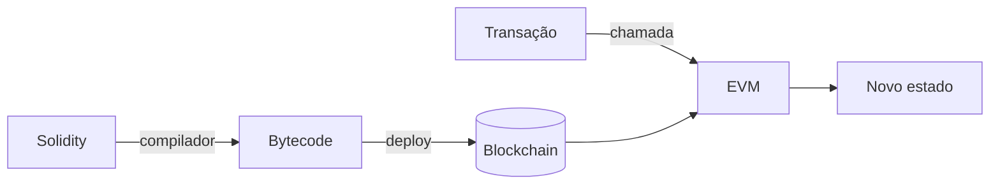
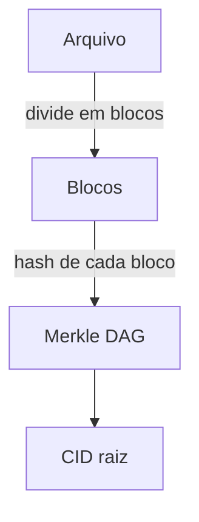
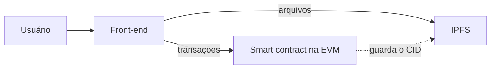

# {{ $slidev.configs.title }}
{{ $slidev.configs.description }}

---

# Objetivos de Aprendizagem

---

# Agenda

- Trilema da escalabilidade
- Tipos de redes
- EVM
- IPFS

---
layout: section
---

# Trilema da Escalabilidade

- Descentralização
- Segurança
- Escalabilidade

---

# Trilema da Escalabilidade
Descentralização

> Refere-se a quantidade de nós validadores necessários para aprovar um bloco.

> Quanto maior a quantidade de nós, maior a resistência a censura

---

# Resistência a Censura
*Censorship resistance*

- Rede descentralizada
- Nenhum nó isoladamente é capaz de bloquear ou apagar uma transação
- Para reescrever o histórico seria necessário controlar mais de 50% da rede (Ataque de 51%)

[O que é um ataque de 51% e quais são os riscos?](https://www.coinbase.com/pt-br/learn/crypto-glossary/what-is-a-51-percent-attack-and-what-are-the-risks)

---

# Resistência a Censura
*Censorship resistance*

> Diferente de uma *blockchain*, onde o poder é distribuído por milhares de nós independentes, nas redes centralizadas existe um ponto único de falha. O proprietário dos servidores dita as regras de forma absoluta.

---

# Trilema da Escalabilidade
Segurança

- Confiança é distribuída por toda a rede, em vez de depender de uma entidade única
- Se apoia em três pilares fundamentais: 
    - Criptografia avançada, 
    - Mecanismos de consenso
    - Descentralização
- Juntos, esses elementos garantem que as informações registradas sejam praticamente invioláveis e imutáveis.

---

# Trilema da Escalabilidade
Escalabilidade

> Capacidade de processar transações (*throughput*)

---

# Trilema da Escalabilidade
Escalabilidade

> Capacidade da rede de processar um grande volume de Transações Por Segundo (TPS) de forma rápida e barata.

---

# Escalabilidade
Gargalos

- Processamento de CPU
- Largura de banda
- Armazenamento de estado

---
layout: section
---

# Tipos de Redes

---

# Tipos de Redes

- Públicas
- Privadas
- Consórcio
- Híbridas
- Camadas (L1 e L2)

---

# Tipos de Redes
Como as BC são classificadas

> A classificação depende de **quem pode participar**, ou seja quem lê os dados, quem envia transações e quem valida os blocos.

---

# Tipos de Redes
Como as BC são classificadas

- **Sem permissão** (*permissionless*): qualquer pessoa entra na rede
- **Com permissão** (*permissioned*): a entrada é controlada por uma ou mais organizações

---

# Redes Públicas
*Permissionless*

- Qualquer pessoa pode ler, enviar transações e participar da validação
- Exemplos: Bitcoin, Ethereum, Solana
- Alta descentralização e resistência a censura
- Transparência total (todo o histórico é auditável)

---

# *Permissionless*
Desvantagens  

> Menor *throughput* e maior custo por transação (taxas)

---

# Redes Privadas
*Permissioned*

- Uma única organização controla quem participa e quem valida
- Exemplos: Hyperledger Fabric e Hyperledger Besu (em modo privado)
- Alto desempenho e baixo custo por transação
- Privacidade dos dados

---

# *Permissioned*
Desvantagens

> Pouca descentralização, logo a confiança volta a depender de uma entidade central

---

# Redes de Consórcio
*Federated*

- Controladas por **um grupo de organizações**, não por apenas uma
- Cada organização opera seus próprios nós validadores
- Muito usadas em cadeias de suprimentos, setor financeiro e governo
- Exemplo no Brasil: Rede Blockchain Brasil (RBB), iniciativa do BNDES e do TCU
- Meio-termo: mais distribuída que a privada, mais controlada que a pública

---

# Redes Híbridas

> Combinam características de redes públicas e privadas.

---

# Redes Híbridas
Características

- Dados sensíveis ficam em uma rede privada
- Uma **âncora** (por exemplo, um *hash*) é registrada em uma rede pública
- Resultado: privacidade e desempenho, com a garantia de imutabilidade da rede pública

---

# Comparativo

| | Pública | Privada | Consórcio |
|---|---|---|---|
| Quem participa | Qualquer pessoa | Uma organização | Grupo de organizações |
| Descentralização | Alta | Baixa | Média |
| Resistência a censura | Alta | Baixa | Média |
| Desempenho (TPS) | Menor | Maior | Maior |
| Privacidade | Baixa | Alta | Alta |
| Exemplo | Ethereum | Hyperledger Fabric | RBB |

---

# Tipos de Redes e o Trilema

- **Públicas**: priorizam descentralização e segurança, sacrificando escalabilidade
- **Privadas e de consórcio**: ganham escalabilidade, sacrificando descentralização
- Nenhuma solução é "a melhor": a escolha depende do caso de uso

> Como escalar uma rede pública sem abrir mão da descentralização?

---

# Camadas
*Layer* 1 e *Layer* 2

- **Layer 1 (L1)**: a rede base, responsável por consenso e segurança (Bitcoin, Ethereum)
- **Layer 2 (L2)**: executa transações fora da L1 e publica o resultado nela
- A L2 herda a segurança da L1 e reduz custo e congestionamento
- Exemplos de L2 no Ethereum: Arbitrum, Optimism, Base

---

# Rollups
Principal solução de L2

- Executam transações fora da L1 e registram na L1 os dados e o resultado
- **Optimistic Rollups**: assumem que as transações são válidas e abrem uma janela para contestação (*fraud proofs*)
- **ZK Rollups**: enviam uma prova criptográfica de validade (*validity proofs*)
- *Sidechains* são diferentes: têm segurança e consenso próprios, independentes da L1

---
layout: section
---

# EVM
*Ethereum Virtual Machine*

---

# EVM
*Ethereum Virtual Machine*

- Máquina virtual
- Contratos inteligentes
- Gas
- Redes compatíveis

---

# *Ethereum Virtual Machine*

> Máquina virtual que executa o código dos contratos inteligentes do Ethereum.

---

# *Ethereum Virtual Machine*

- Todos os nós da rede executam a mesma EVM
- Garante que o mesmo código, com a mesma entrada, produza **o mesmo resultado** em qualquer nó (determinismo)
- Funciona como um "computador global" compartilhado, cujo estado é replicado por toda a rede

---

# Estado e Contas

> A EVM mantém o **estado global** da rede: um mapa de endereços para contas.

- **EOA** (*Externally Owned Account*): controlada por uma chave privada
- **Conta de contrato**: possui código e armazenamento próprios, sem chave privada
- Cada conta tem: saldo, *nonce* e, no caso de contratos, código e armazenamento
- Uma transação altera o estado de uma `EOA` para outra, ou chama um contrato

---

# Do código à execução



- Linguagens como **Solidity** e **Vyper** são compiladas para *bytecode*
- A EVM executa o *bytecode* por meio de **opcodes**, instruções simples como `ADD`, `SSTORE` e `CALL`

---

# Como a EVM executa

- Arquitetura baseada em **pilha** (*stack*), com palavras de 256 bits
- Três áreas de dados:
    - **Stack**: valores temporários da execução
    - **Memory**: temporária, apagada ao final da chamada
    - **Storage**: permanente, parte do estado do contrato
- Cada execução é isolada: um erro reverte todas as alterações da transação

---

# Exemplo de Contrato

```solidity
// SPDX-License-Identifier: MIT
pragma solidity ^0.8.20;

contract Contador {
    uint256 public valor;

    function incrementar() public {
        valor += 1;
    }
}
```

- `valor` fica no **storage** do contrato
- Chamar `incrementar()` é uma transação que altera o estado e consome *gas*

---

# *Gas*

> Unidade que mede o esforço computacional de cada operação na EVM.

- Cada `opcode` tem um custo em *gas* (escrever no *storage* é muito mais caro que somar)
- Quem envia a transação paga: **gas usado × preço do gas**
- Define um **gas limit**: se o gas acabar, a execução é revertida
- Evita laços infinitos e abuso da rede

---

# Gas
Taxas após a EIP-1559 (*Ethereum Improvement Proposal*)

- **Base fee**: definida pela rede conforme a demanda, e queimas
- **Priority fee** (gorjeta): paga ao validador para priorizar a transação
- Relação com o trilema: o gas é o mecanismo que torna a escalabilidade um recurso escasso

---

# Redes Compatíveis com a EVM

> Redes que executam o mesmo *bytecode* e, por isso, aceitam os mesmos contratos e ferramentas.

- L1: BNB Chain, Avalanche (C-Chain), Polygon PoS
- L2: Arbitrum, Optimism, Base
- Vantagem: o mesmo contrato em Solidity pode ser implantado em várias redes
- Ferramentas reaproveitadas: MetaMask, Hardhat, Foundry, Ethers.js

---

# EVM
Limitações

- Execução **sequencial** e replicada em todos os nós (limita a escalabilidade)
- Armazenamento *on-chain* é caro
- Não acessa dados externos diretamente (usa **oráculos**)

---
layout: fact
---

# Como guardar arquivos grandes (imagens, documentos) sem pagar altas taxas de gas?

---
layout: section
---

# IPFS
*InterPlanetary File System*

- Armazenamento descentralizado
- Endereçamento por conteúdo
- Uso conjunto com a BC

---

# O problema do armazenamento

- Guardar dados *on-chain* é muito caro
- Na web tradicional, o arquivo fica em **um servidor** (ponto único de falha e sujeito a censura)
- Se o servidor sai do ar ou o *link* muda, o conteúdo se perde (*link rot*)

---
layout: fact
---

# Como armazenar arquivos de forma descentralizada e verificável?

---

# O que é o IPFS?

> Protocolo e rede *peer-to-peer* para armazenar e compartilhar arquivos de forma distribuída.

- Os arquivos são distribuídos entre vários nós (*peers*)
- Qualquer pessoa pode rodar um nó
- Não depende de um servidor central

---

# Endereçamento por Conteúdo

| HTTP (localização) | IPFS (conteúdo) |
|---|---|
| Pergunta: **onde** está o arquivo? | Pergunta: **o que** é o arquivo? |
| `https://site.com/foto.png` | `ipfs://bafy...` |
| O conteúdo pode mudar sem aviso | Alterou o conteúdo, mudou o endereço |
| Depende do servidor | Qualquer nó que tenha o conteúdo serve |

---

# CID
*Content Identifier*

- Identificador único do conteúdo, gerado a partir de seu **hash criptográfico**
- Mesmo conteúdo gera sempre o mesmo CID
- Qualquer alteração, por menor que seja, gera um CID diferente
- O CID permite **verificar a integridade**: quem recebe o arquivo recalcula o hash e confere
- Formatos: CIDv0 (começa com `Qm`) e CIDv1 (por exemplo, `bafy...`)

---

# Como o IPFS é armazenado?



- Arquivos grandes são divididos em **blocos** (*chunking*)
- Cada bloco recebe seu hash e todos formam uma estrutura em árvore, o **Merkle DAG**
- O CID da raiz representa o arquivo inteiro
- Blocos idênticos são armazenados uma única vez (deduplicação)

---

# Como encontrar e transferir

- **DHT** (*Distributed Hash Table*): tabela distribuída que informa quais nós possuem determinado CID
- **Bitswap**: protocolo de troca de blocos entre os nós
- **Gateways**: servidores que permitem acessar conteúdo IPFS por HTTP, sem rodar um nó
- **IPNS**: nomes mutáveis que apontam para um CID, útil quando o conteúdo é atualizado

---

# Persistência
*Pinning*

- Um nó guarda os dados temporariamente e pode descartá-los (*garbage collection*)
- **Pin**: marca o conteúdo para que o nó o mantenha
- O IPFS **não garante** persistência por si só: alguém precisa manter o conteúdo "fixado"
- Soluções: serviços de *pinning* (Pinata, Filebase) ou a rede **Filecoin**, que adiciona incentivo econômico ao armazenamento

---

# IPFS + Blockchain

> Padrão comum: **arquivo no IPFS, CID na blockchain**.

1. O arquivo é enviado ao IPFS e gera um CID
2. O CID (poucos bytes) é registrado em um contrato inteligente
3. Qualquer pessoa pode buscar o arquivo e conferir que ele não foi alterado

- Exemplos: metadados e imagens de **NFTs**, documentos, dados de **dApps**
- Ganho: custo baixo na rede e integridade garantida pelo hash

---

# IPFS
Limitações

- Não é privado: o conteúdo é público para quem tem o CID (criptografe antes, se necessário)
- Sem *pinning*, o conteúdo pode desaparecer
- Desempenho pode variar em relação a servidores tradicionais
- Não é "apagável": o conteúdo pode continuar em outros nós

---

# Arquitetura de um dApp



- **Lógica e estado** críticos: contratos inteligentes na EVM
- **Arquivos** e front-end: IPFS
- Resultado: um software verdadeiramente **descentralizado**

---

# Resumo

- **Trilema**: descentralização, segurança e escalabilidade, e a dificuldade de ter os três
- **Tipos de redes**: públicas, privadas, consórcio e híbridas, além de L1 e L2
- **EVM**: o computador global que executa contratos inteligentes, com custo medido em gas
- **IPFS**: armazenamento descentralizado por conteúdo, complemento ideal da blockchain

---

# Referências

- [O que é um ataque de 51% e quais são os riscos?](https://www.coinbase.com/pt-br/learn/crypto-glossary/what-is-a-51-percent-attack-and-what-are-the-risks)

- [Máquina Virtual Ethereum (EVM) - ethereum.org](https://ethereum.org/pt-br/developers/docs/evm/)

- [Gás e taxas - ethereum.org](https://ethereum.org/pt-br/developers/docs/gas/)

- [EIP-1559](https://www.binance.com/pt-BR/academy/glossary/eip-1559)

- [Documentação do IPFS](https://docs.ipfs.tech/)

---
layout: fact
---

# Perguntas

---
src: /snippets/end.md 
---
