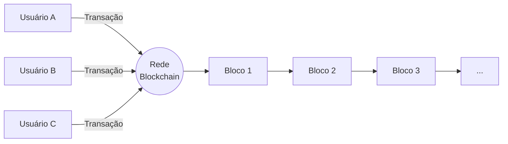
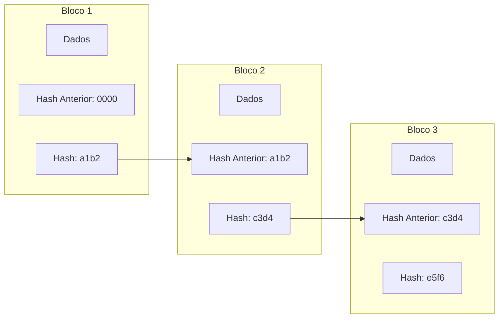

# Tecnologia Blockchain
Introdução

---

# Objetivos de Aprendizagem

- Compreender os conteitos iniciais da tecnologia *Blockchain*

---

# Agenda

- Conceito de *Blockchain*
- Funcionamento

---
layout: section
---

# Conceito de *Blockchain*

---

# O que é Blockchain?

> Um **livro-razão digital compartilhado e imutável** que permite o registro de transações e o rastreamento de ativos dentro de uma rede.

<v-click>

> Opera como um **banco de dados descentralizado e distribuído**, com dados armazenados em vários computadores, tornando-o resistente a adulterações.

</v-click>

<v-click>

> As transações são validadas por um **mecanismo de consenso**, garantindo o acordo em toda a rede — sem depender de intermediários tradicionais.

</v-click>

<v-click>


<div class="flex items-center justify-center">



</div>

</v-click>

---

# Por que a *Blockchain* existe?
O problema

> Antes da blockchain, transações digitais dependiam de **intermediários confiáveis** (bancos, cartórios, plataformas).

<v-click>

Ocasionando
- Custos elevados
- Ponto único de falha
- Necessidade de confiar em terceiros
- Risco de fraude e manipulação

</v-click>

---

# Por que a *Blockchain* existe?
A solução

> A *blockchain* propõe um sistema **peer-to-peer**, onde a confiança é construída pela própria rede com características próprias.

- **Descentralização** Não há autoridade central
- **Transparência** Todos podem auditar
- **Imutabilidade** Registros não podem ser alterados
- **Consenso** A rede é validada coletivamente

---

# Principais Características

- Livro-razão (*Ledger*) distribuído
- Registros imutáveis
- Contratos inteligentes
- Criptografia de chave pública

---
layout: quote
---

# Principais Características
Livro-razão (*Ledger*) distribuído

> Todos os participantes têm acesso ao mesmo registro. Cada transação é registrada **uma única vez**, eliminando duplicações.

---
layout: quote
---

# Principais Características
Registros imutáveis

> Uma vez registrada, uma transação **não é possível alterá-la**. Correções exigem uma nova transação, e ambas ficam visíveis.

---
layout: quote
---

# Principais Características
Contratos inteligentes

> Acordos **autoexecutáveis** escritos em código. Quando as condições predefinidas são atendidas, a próxima etapa é acionada automaticamente.

---
layout: quote
---

# Principais Características
Criptografia de chave pública

> **Chave pública** = endereço para receber. **Chave privada** = autorização para gastar. Garante segurança e propriedade.


---
layout: section
---

# Como a *Blockchain* Funciona?

---

# Blocos e a Cadeia


> Cada transação é agrupada em um **bloco** de dados, que contém:

- Quem, o quê, quando, onde
- O valor da transação
- Um **timestamp** (data e hora exata)
- O **hash** do bloco anterior

<v-click>

Os blocos são **encadeados** por hashes criptográficos, formando uma sequência cronológica e segura.

</v-click>

<v-click>

Alterar um bloco exigiria recalcular **todos os blocos subsequentes** — algo praticamente inviável.

</v-click>

---

<div class="flex items-center justify-center">



</div>

---

# O Papel do Hash

> Um **hash criptográfico** é um identificador único gerado a partir dos dados de um bloco.

Propriedades
- **Determinístico:** mesma entrada → mesmo hash
- **Unidirecional:** não é possível reverter
- **Sensível:** qualquer mudança mínima altera o hash completamente

### Exemplo prático

```text
Entrada: "Olá, mundo"
Hash:    8f4e2a1b9c...

Entrada: "Olá, Mundo"  (M maiúsculo)
Hash:    d7a3f9e2c1...  (completamente diferente)
```

<v-click>

É essa sensibilidade que garante a **integridade** da cadeia: se alguém alterar um bloco, o hash muda, e a fraude se torna evidente.

</v-click>

---
layout: section
---

# Mecanismos de Consenso

---
layout: quote
---

# O que é Consenso?

> Em uma rede descentralizada, **não há um chefe** para decidir qual transação é válida.

---

> O **mecanismo de consenso** é o conjunto de regras que permite que **computadores que não confiam uns nos outros** concordem sobre a "verdade" — ou seja, sobre qual é o próximo bloco válido da cadeia.

---

# Por que o consenso é necessário?

- Evita **gastos duplos** (usar a mesma moeda duas vezes)
- Impede que um participante mal-intencionado **reescreva o histórico**
- Garante que todos os nós tenham a **mesma visão** do livro-razão

---

# Proof of Work (PoW)
A ideia central

> Os participantes (**mineradores**) competem para resolver um **quebra-cabeça matemático** difícil.

- O primeiro a resolver propõe o próximo bloco
- Os outros nós **verificam** facilmente a solução
- O vencedor recebe uma **recompensa**

---

# Analogia

> É como uma competição para abrir um cofre. O vencedor prova que fez o trabalho — daí o nome "**Proof of Work**".

---

# Características
PoW

<div class="mt-4 space-y-2">

<div class="p-3 rounded bg-green-500 bg-opacity-10">
✅ Alta segurança — atacar exige poder computacional enorme
</div>

<div class="p-3 rounded bg-red-500 bg-opacity-10">
❌ Alto consumo de energia
</div>

<div class="p-3 rounded bg-red-500 bg-opacity-10">
❌ Baixa escalabilidade (transações lentas)
</div>

<div class="p-3 rounded bg-blue-500 bg-opacity-10">
💡 Usado pelo **Bitcoin**
</div>

</div>

---

# Proof of Stake (PoS)

### A ideia central

Em vez de competir com poder computacional, os participantes (**validadores**) **apostam** suas próprias criptomoedas como garantia.

- O protocolo escolhe um validador proporcional à sua aposta
- Se o validador agir de má-fé, **perde a aposta**
- Se agir corretamente, recebe recompensas

<v-click>

### Analogia

É como um **depósito de garantia**: quanto mais você aposta, mais confiança a rede deposita em você — mas também mais você tem a perder.

</v-click>


### Características

✅ Muito mais eficiente em energia
✅ Maior escalabilidade
⚠️ Risco de centralização (grandes apostadores)
💡 Usado pelo **Ethereum** (desde 2022)

---

# PoW vs PoS — Comparação

| Critério                | Proof of Work (PoW)        | Proof of Stake (PoS)     |
| ----------------------- | -------------------------- | ------------------------ |
| **Recurso principal**   | Poder computacional        | Criptomoedas apostadas   |
| **Consumo de energia**  | 🔴 Muito alto              | 🟢 Muito baixo           |
| **Velocidade**          | 🔴 Lenta                   | 🟢 Rápida                |
| **Segurança**           | 🟢 Altíssima               | 🟢 Alta                  |
| **Barreira de entrada** | 🔴 Equipamentos caros      | 🟢 Apenas capital        |
| **Risco principal**     | Centralização de mineração | Centralização de capital |
| **Exemplo**             | Bitcoin                    | Ethereum                 |

---
layout: statement
---

# A confiança não vem de uma autoridade central.

## Vem da matemática, da criptografia e do consenso da rede.

---

# Resumo do Conceito


### O que é

Um **livro-razão digital** descentralizado, imutável e compartilhado, onde a confiança é construída pela rede.


### Como funciona

Transações viram **blocos**, que são **encadeados** por hashes e validados por um **mecanismo de consenso**.


### Como se protege

**Criptografia** garante propriedade. **Hashes** garantem integridade. **Consenso** garante acordo.


### Como evoluiu

Do **Bitcoin** (2008) ao **Ethereum** (2015), chegando a **DeFi**, **NFTs** e integrações com **IA** e **IoT**.

---

# Referências

- IBM. _O que é Blockchain?_ — [ibm.com/br-pt/think/topics/blockchain](https://www.ibm.com/br-pt/think/topics/blockchain)
- Binance Academy. _Mecanismos de Consenso_ — [https://www.binance.com/pt-BR/academy/articles/what-is-a-blockchain-consensus-algorithm](https://academy.binance.com/pt)


---
layout: center
class: text-center
---

# Obrigado!


